# Menu-bar gallery

TokenPulse covers all seven supported styles across all four allowance providers (28 examples), all five providers individually and together, both spend-compatible styles for OpenAI and work spend (8 examples), themed/standard marks, capsule backgrounds, every size, and allowance statuses.

Every icon/capsule is produced by the app’s real drawing functions. Sample values are fictional. Labeled sheets enlarge rendered PNGs 2×; the combined TokenPulse strip retains its original Retina pixels. No account data, credentials, private repository data, job state, or live prices are read. The entry point never starts the production backend and blocks network requests.

## Regenerate only menu-bar previews

```bash
npm install
npm run build:electron
npx electron scripts/menu-screenshots.cjs
```

Run on macOS for the same renderer/font environment. `scripts/screenshots/menu.cjs` defines examples and calls production drawing functions; `menu-board.cjs` supplies presentation labels and backdrops. `docs/screenshots/menu-manifest.json` records the generated image dimensions. The regular full screenshot command also includes these menu previews.

OpenAI balance/spend is never shown as an allowance percentage. Work spend uses Divider capsule or Compact stack; gauge and track styles are used only for allowance providers. The code’s style numbers and names are used directly. `menu-coverage.json` records the provider/style coverage.

## Menu Bar Combined

One combined menu bar with ChatGPT, Cursor, Grok Bot, OpenAI API, and Claude, each using its own supported style.


## Menu Bar

All seven menu-bar styles, rendered by production code with fictional allowance values.

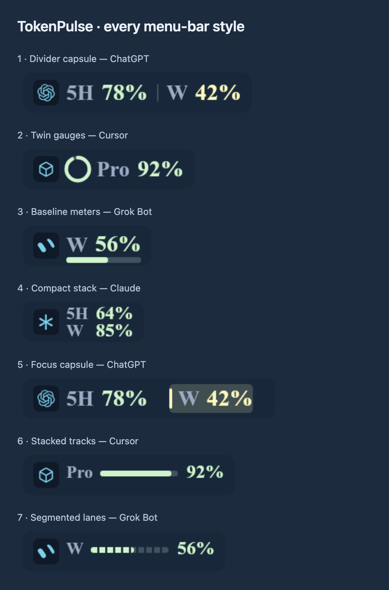

## Menu Bar Providers

Every provider appears: ChatGPT, Cursor, Grok Bot, OpenAI API, and Claude. OpenAI shows money rather than quota gauges.

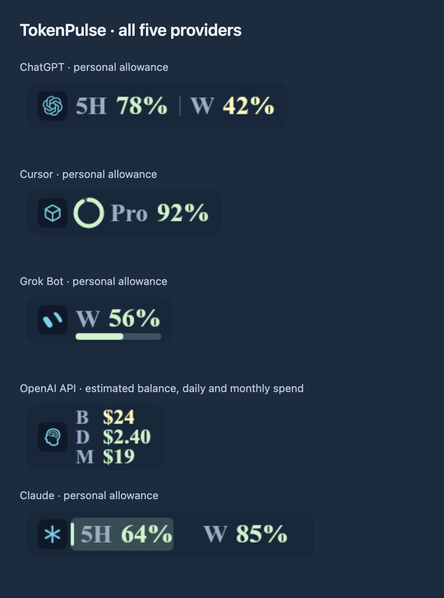

## Menu Bar Style Divider

Divider capsule with each allowance provider: ChatGPT, Cursor, Grok Bot, and Claude.

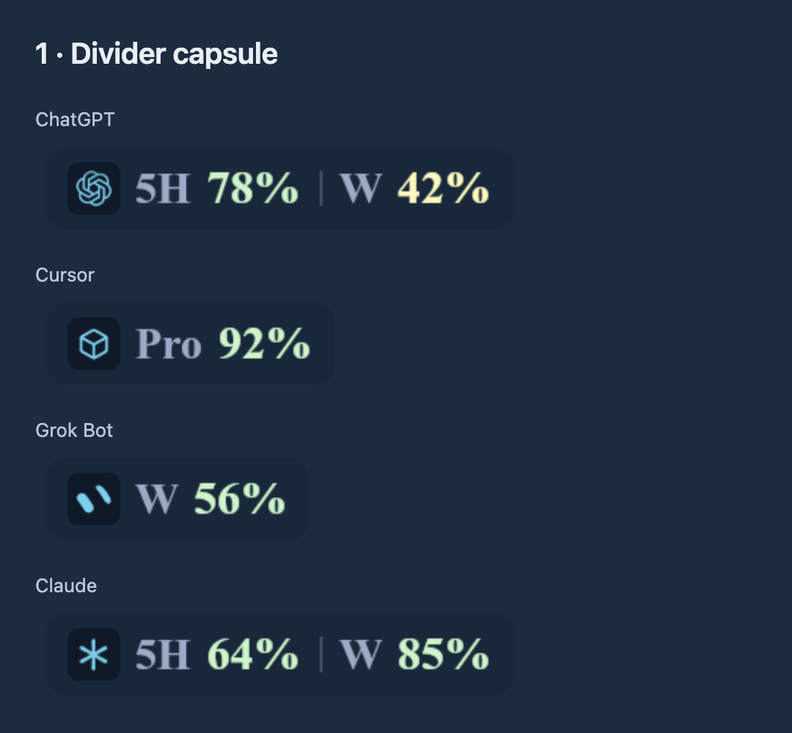

## Menu Bar Style Rings

Twin gauges with each allowance provider: ChatGPT, Cursor, Grok Bot, and Claude.

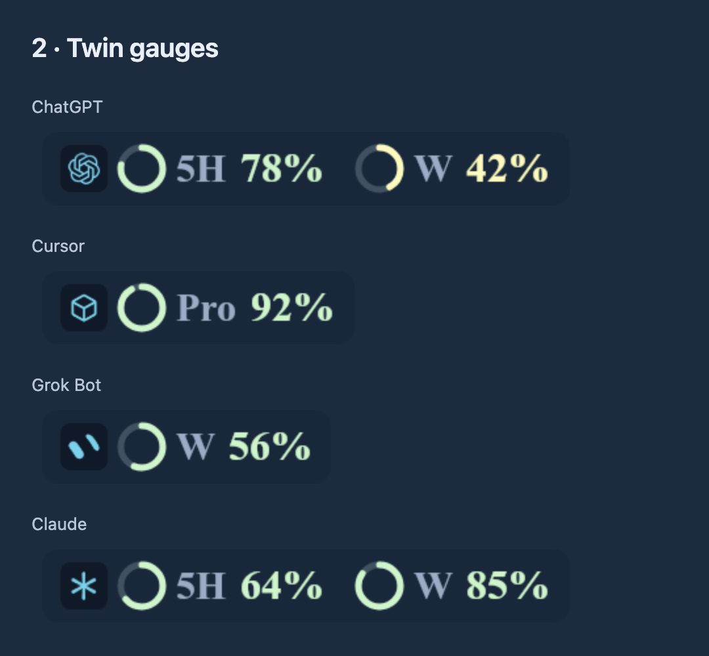

## Menu Bar Style Baseline

Baseline meters with each allowance provider: ChatGPT, Cursor, Grok Bot, and Claude.

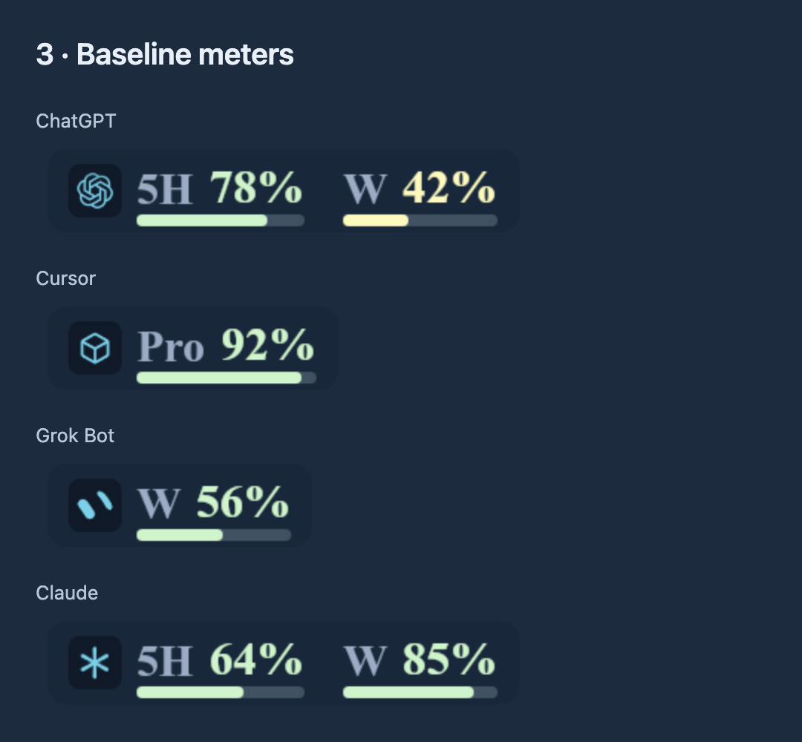

## Menu Bar Style Stack

Compact stack with each allowance provider: ChatGPT, Cursor, Grok Bot, and Claude.

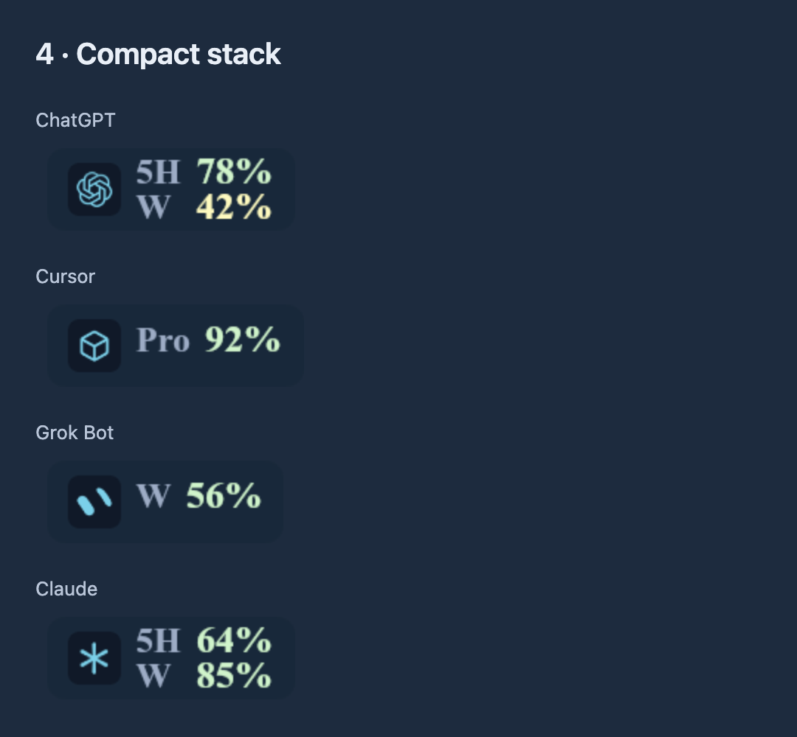

## Menu Bar Style Focus

Focus capsule with each allowance provider: ChatGPT, Cursor, Grok Bot, and Claude.

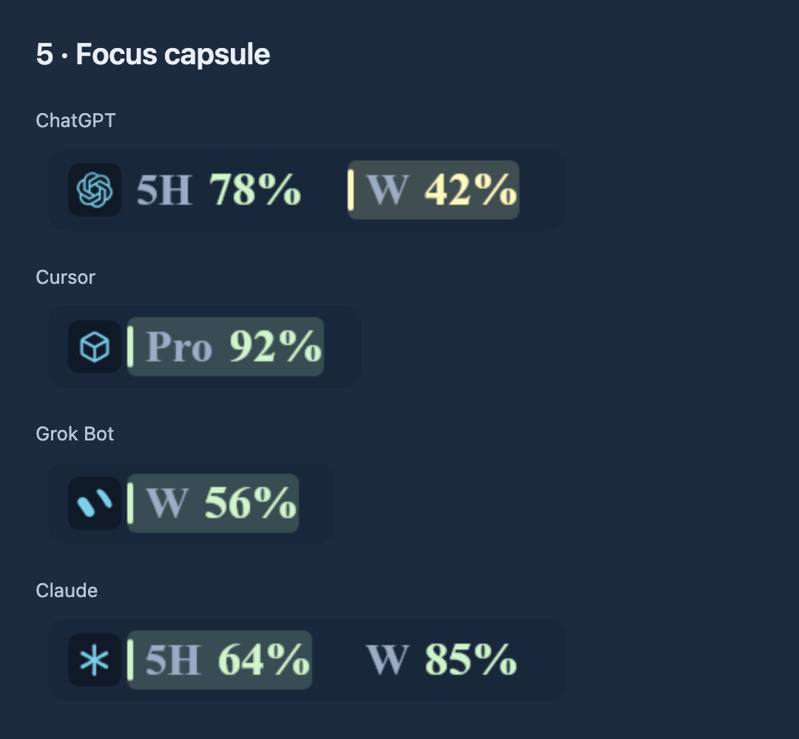

## Menu Bar Style Lanes

Stacked tracks with each allowance provider: ChatGPT, Cursor, Grok Bot, and Claude.

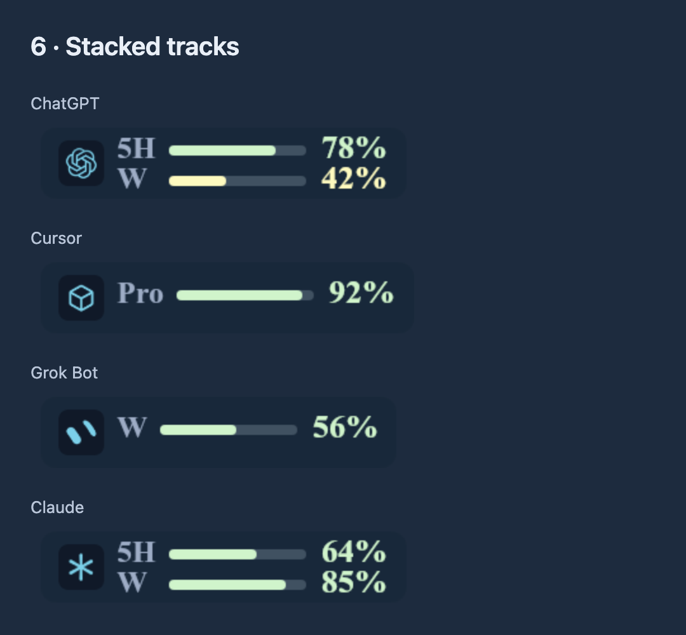

## Menu Bar Style Segments

Segmented lanes with each allowance provider: ChatGPT, Cursor, Grok Bot, and Claude.

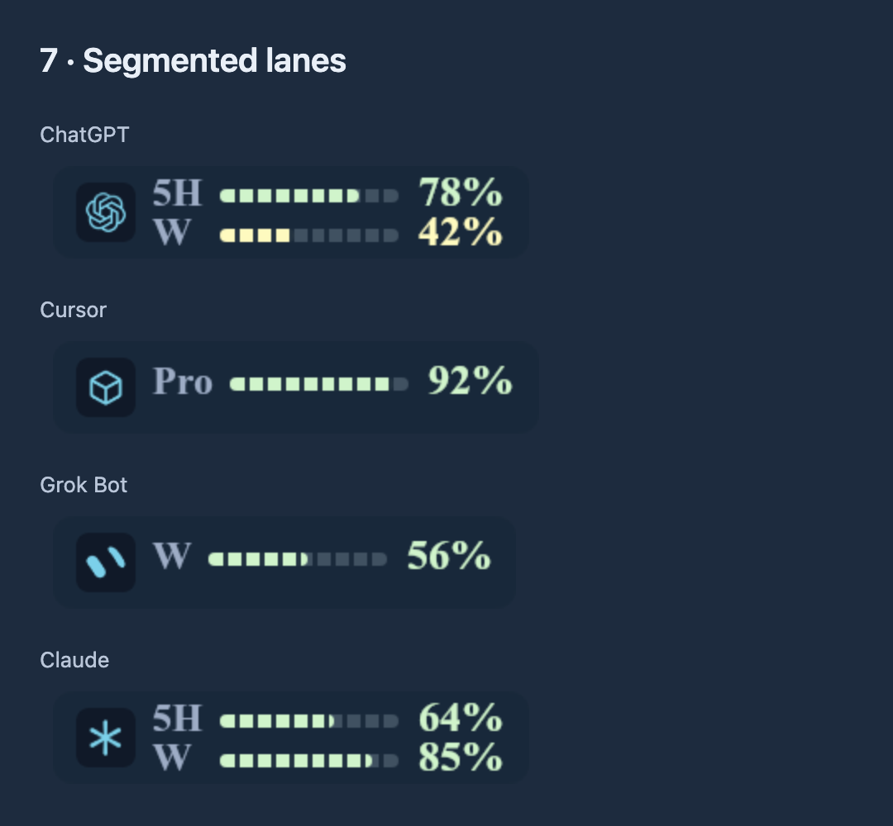

## Menu Bar Spend

Both supported spend layouts for OpenAI balance and ChatGPT, Cursor, and Claude work spend. Dollar figures never use quota gauges.

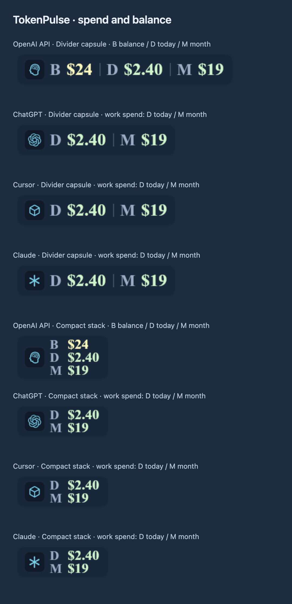

## Menu Bar Appearance

ChatGPT and OpenAI examples with themed marks, standard marks, and capsule backgrounds switched off.

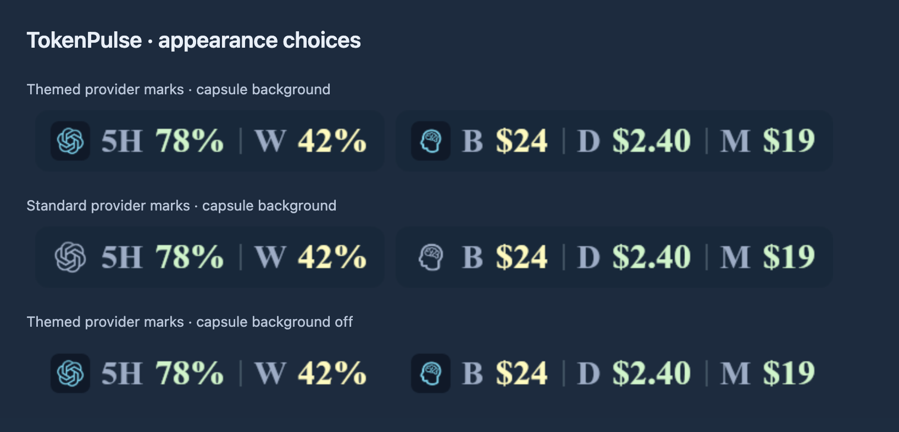

## Menu Bar Sizes

All eight supported menu-bar sizes, from Normal (100%) to Micro (65%), using the Compact stack style.

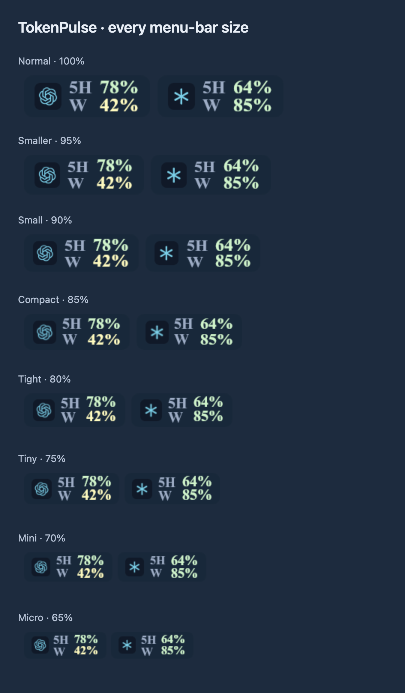

## Menu Bar Status

Healthy, low, exhausted, and stale allowance states using production status and tint logic.

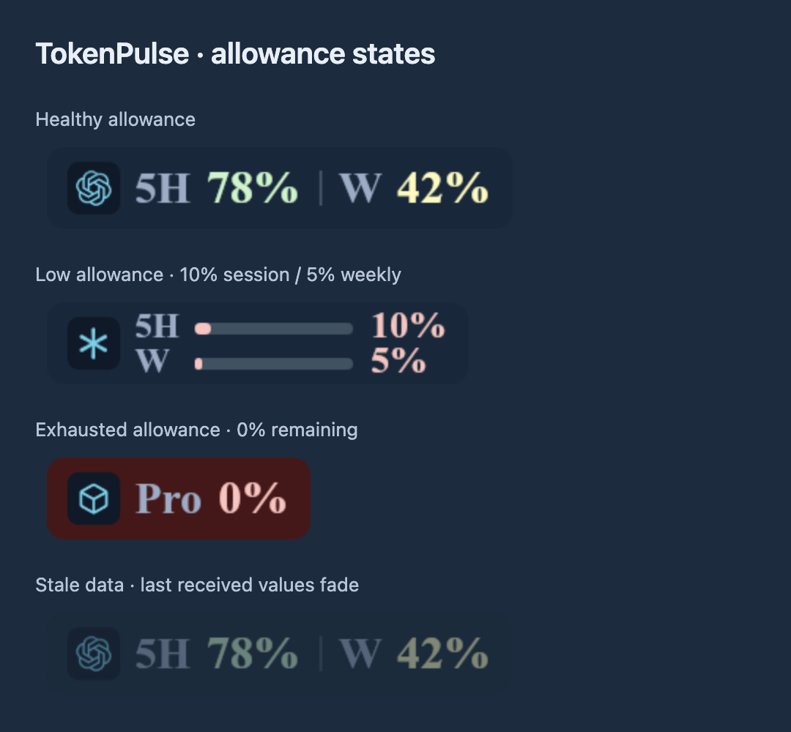
